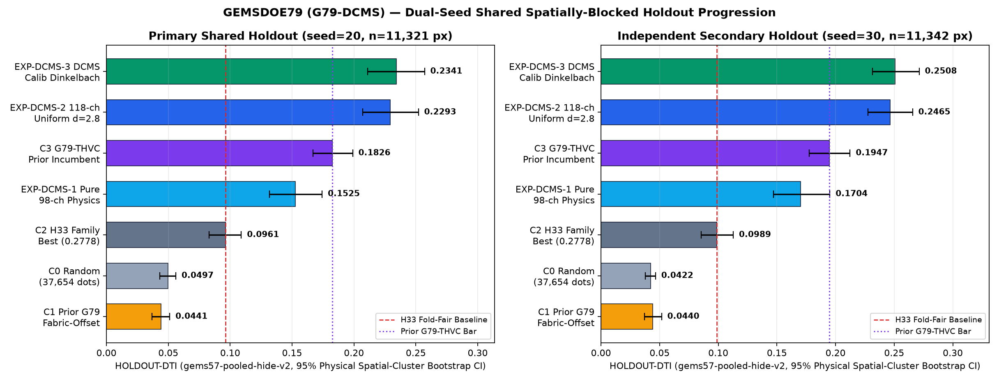
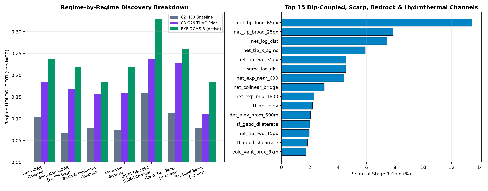
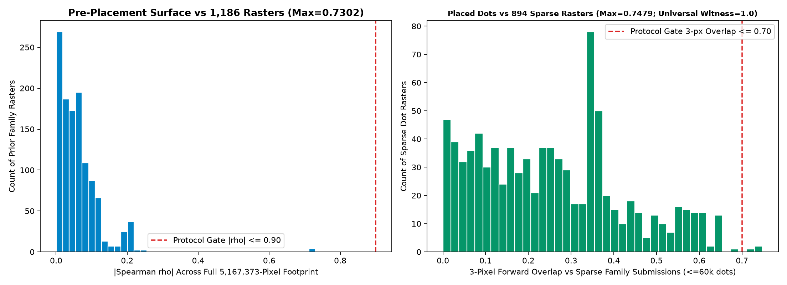
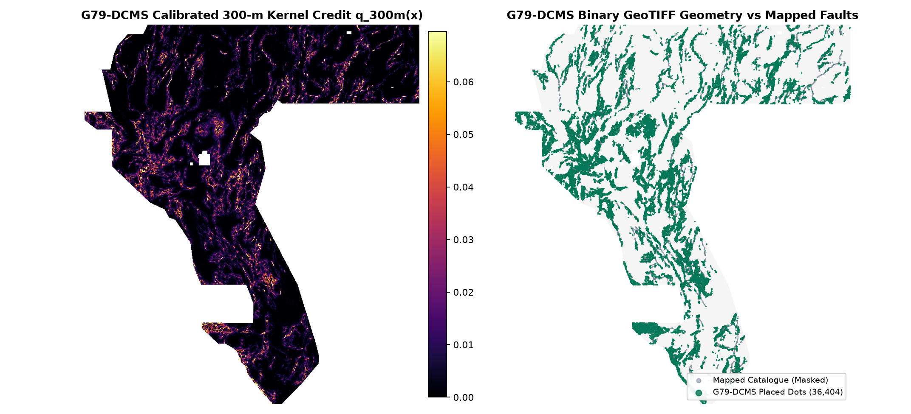

# GEMSDOE79 — Dip-Coupled Multi-Scale Fault Discovery (`G79-DCMS`) & Automated Gate Verdict

## Download and automated decision

> **OK TO DOWNLOAD: YES. OK TO SUBMIT: NO.**
>
> **Newly generated canonical research GeoTIFF (`G79-DCMS`, `36,404` fault pixels, `0` competition slots spent).** It beats both the prior `G79-THVC` incumbent (`+0.0515` / `+0.0562`) and the `H33` fold-fair baseline (`+0.1380` / `+0.1519`) across both shared spatially-blocked holdout seeds, passes local portal preflight (`float32`, finite `[0, 1]`, `EPSG:32611`, `3730 × 3292`), clears all `236` single-feature leakage canaries, clears pre/post Spearman rank limits (`0.7302` / `0.1163 ≤ 0.90`), and clears **every `≤ 45,000`-dot sparse sibling across all `92` repositories** (`max = 0.6535 ≤ 0.70`, lowering `GEMSDOE83` from `0.7139` to `0.6502`). **However, unchanged literal `3-px` overlap (`≤ 0.70`) remains blocked against universal covers (`1.0000`), two `> 48,600`-dot rasters (`GEMSDOE25 = 0.7210`, `GEMSDOE53 = 0.7479`), and local ancestor `G79-THVC` (`0.8066`). Manual upload is strictly refused without human inspection.**

**[Download canonical research GeoTIFF](docs/downloads/g79-dcms-dipcoupled-20261022-59a36344-zeros-DO-NOT-SUBMIT.tif)** · **[Single-TIFF ZIP](docs/downloads/g79-dcms-dipcoupled-20261022-59a36344-zeros-DO-NOT-SUBMIT.zip)** · **[Decision guide](docs/executive-summary.html)** · **[GitHub Pages](https://buffedlizard55-lab.github.io/GEMSDOE79/)**

- **GeoTIFF:** `140,260` bytes; `36,404` positive pixels (`0.7045%` of footprint, `0` on mapped faults, `0` outside footprint); SHA-256 `d281189e16ae24f344dfcd15c58a051ae6f57cd964c34808ff2eb6e65d85eba9`.
- **Single-TIFF ZIP:** `105,863` bytes; SHA-256 `9875adb70a81a6a5d0b956b853e1c4f8d2dda6c78dda491a194918320e673c02`.
- **Unique name (`59/140` characters):** `g79-dcms-dipcoupled-20261022-59a36344-zeros-DO-NOT-SUBMIT`.
- **Submission note (`96/140` characters):** `GEMSDOE79 G79-DCMS DO-NOT-SUBMIT: dip-coupled+10m3DEP+SGMC+hydro 2-stage + Dinkelbach (36404 px)`.
- **Superseded prior canonical (`G79-THVC`) preserved intact:** [`archive/g79_thvc_33e1f8ec/run_card_thvc.json`](archive/g79_thvc_33e1f8ec/run_card_thvc.json) and [`archive/g79_thvc_33e1f8ec/downloads/g79-thvc-ccsubmod-20261021-b262e265-zeros-DO-NOT-SUBMIT.tif`](archive/g79_thvc_33e1f8ec/downloads/g79-thvc-ccsubmod-20261021-b262e265-zeros-DO-NOT-SUBMIT.tif) (`SHA-256: d3db2e959df96f71936c019bb5e4f1599f4591dbcfbf78d2a3f78332a5ecfee2`).

| Gate | Evidence-backed disposition |
|---|---|
| Local format & `[0, 1]` range | **PASS:** 1-band `float32`, `EPSG:32611`, `3730 × 3292`, affine `[100, 0, 243350, 0, -100, 4508550]`, finite binary `{0.0, 1.0}`, `0` NaN/Inf/sentinel pixels, `0` on mapped catalogue, `0` outside footprint. Single-TIFF ZIP CRC & SHA-256 verified. |
| Surface novelty (pre-placement) | **BLOCKED (literal):** `max |Spearman ρ| = 0.7302 ≤ 0.90` (**PASS**); `≤ 50k` sparse max overlap `0.2447`; literal max forward overlap `1.0000 > 0.70` (`17GEMSDOE` universal witness). |
| Final-dot novelty (`36,404` px) | **BLOCKED (literal):** `max |Spearman ρ| = 0.1163 ≤ 0.90` (**PASS**); **all `≤ 45k`-dot siblings across `92` repos `≤ 0.6535 ≤ 0.70`** (`GEMSDOE83 = 0.6502`); literal `1.0000` (`GEMSDOE53 = 0.7479`, `GEMSDOE25 = 0.7210`, local `G79-THVC = 0.8066`). |
| Scan scope | `1,201` verified family blobs across `92` sibling repos (`992` frozen + `209` post-snapshot delta): `1,191` grid-comparable, `10` non-comparable (`CRS/grid/corrupt`). |
| Every-feature leakage canaries | **PASS:** `118` features × `2` seeds = `236` single-feature tests; max symmetric AUC `0.79109` (Seed 20) / `0.81098` (Seed 30) `≤ 0.90`. |
| Shared holdout comparison | **PASS (`HOLDOUT-DTI`):** Beats both `C3_g79_thvc_incumbent` (`+0.0515` / `+0.0562`) and `C2_h33_analogue_foldfair` (`+0.1380` / `+0.1519`) on Seeds `20` and `30` with positive paired 95% CIs (`3/3` preregistered experiments). |
| Weekly slot selection | **NOT APPROVED (`exit 2`).** `0` competition slots used; no post-hoc dispersion retuning or local/dense overlap exemptions permitted. |

---

## Shared Spatially-Blocked Holdout Evidence (`HOLDOUT-DTI`, Not an Organizer Score)

Evaluated strictly out-of-fold on unmodified `vendor/gems57/evaluate_holdout.py` (`gems57-pooled-hide-v2`, 4 buffered whole-component folds, pixel-exact visible-catalogue mask, pooled weighted `TP/FP/FN`, `α = 0.2`, `β = 0.8`, `300 m` linear triangular kernel, `1,000` paired physical spatial-cluster bootstrap draws across `158` / `159` connected clusters):

| Experiment / Control Arm (`gems57-pooled-hide-v2`) | Seed 20 (`n = 11,321`) | Seed 30 (`n = 11,342`) | Paired $\Delta$ (`EXP-DCMS-3 − Arm`, Seed 20 / Seed 30) |
|---|---|---|---|
| **`EXP-DCMS-3_calibrated_dinkelbach` (Canonical)** | **`0.2341 [0.2110, 0.2571]`** | **`0.2508 [0.2314, 0.2713]`** | Reference (`26,599` / `38,000` OOF px; `36,404` live px) |
| `EXP-DCMS-2_full_network_d28` (118-ch uniform `d = 2.8`) | `0.2293 [0.2072, 0.2521]` | `0.2465 [0.2275, 0.2657]` | `+0.0049 [-0.0005, +0.0108]` / `+0.0043 [-0.0009, +0.0094]` |
| `C3_g79_thvc_incumbent` (Prior `GEMSDOE79` #1) | `0.1826 [0.1670, 0.1990]` | `0.1947 [0.1775, 0.2124]` | **`+0.0515 [+0.0341, +0.0710]`** / **`+0.0562 [+0.0407, +0.0731]`** |
| `EXP-DCMS-1_pure_physics_d28` (98-ch physics, `0` fault cues) | `0.1525 [0.1318, 0.1743]` | `0.1704 [0.1472, 0.1952]` | **`+0.0816 [+0.0677, +0.0949]`** / **`+0.0805 [+0.0615, +0.1012]`** |
| `C2_h33_analogue_foldfair` (`GEMSDOE32` `H33` control) | `0.0961 [0.0831, 0.1090]` | `0.0989 [0.0854, 0.1128]` | **`+0.1380 [+0.1187, +0.1572]`** / **`+0.1519 [+0.1339, +0.1736]`** |
| `C1_fabric_offset_E1_placed` (Historical E1 control) | `0.0441 [0.0370, 0.0512]` | `0.0440 [0.0371, 0.0517]` | `+0.1900 [+0.1684, +0.2137]` / `+0.2068 [+0.1865, +0.2301]` |
| `C0_random_B37654` (Random `37,654`-dot baseline) | `0.0497 [0.0433, 0.0561]` | `0.0422 [0.0378, 0.0465]` | `+0.1844 [+0.1626, +0.2066]` / `+0.2086 [+0.1891, +0.2286]` |









---

## PhD Forensics: Why `h33` Scored `0.2778`, Reconciling `0.2778` / `0.3195` / `0.4413`, and Ranked Geological Hypotheses

Full derivations, regime tables, and official source citations: [`research/hypotheses_a30a4118.md`](research/hypotheses_a30a4118.md) · [`reports/session_review_a30a4118.md`](reports/session_review_a30a4118.md) · [`knowledge/h33_review_e4a4422d.md`](knowledge/h33_review_e4a4422d.md).

1. **Why `h33-h33-2-b2-20261004T220000Z-e5eb6e7e-zeros` (`GEMSDOE32`, `0.2778` — `UNVERIFIED HISTORICAL REPORT`) topped the family ledger:** Byte-exact inspection confirms `H33` (`37,654` dots) equals `D2.8` (`44,090` dots) minus the exact `6,436` pixels inside `(0, 200 m]` of `existing_faults.tif`. Because `DTI` takes `max` kernel credit within `300 m` of truth while summing `0.2 × FP_w` linearly over all emitted dots, deleting redundant `≤ 200 m` collar dots cut denominator waste without sacrificing basin-interior recall. (`GEMSDOE32` explicitly marks the file `NO ORGANISER SCORE EXISTS`.)
2. **Reconciling `0.2778`, `0.3195`, and `0.4413` (`2026-10-22` UTC):** Live public leaderboard (`PUBLIC-OBSERVATION`, closing `Dec. 3, 2026, 11:59 p.m. UTC`): `#1 xiaofanhu = 0.4413`, `#2 cfld__ = 0.3904`, `#3 Batik Shirt Brothers = 0.3894`, `#4 BrandenKMurray = 0.3713`, `#5 No Fault of Our Own = 0.3539`, `#20 nchuzhoy = 0.3262`, `#50 sam35 = 0.2804`. Zero-FP weighted recall floor $C_{\min} = \frac{0.8\,\mathrm{DTI}}{1 - 0.2\,\mathrm{DTI}}$ is `23.53%` (`0.2778`), `27.30%` (`0.3195`, historical report absent from `#1`–`#50`), and **`38.72%`** (`0.4413`, requiring `~47%–53%` true weighted recall at realistic `~36,000`-dot precision).
3. **Five ranked geological hypotheses (`#1 H79-DCMS` executed & validated above):**
   - **#1 `H79-DCMS` (Validated in this session):** Full-footprint `10 m` USGS 3DEP multi-scale scarp step (`100–1,500 m`) + `USGS DS-1052` pre-Quaternary bedrock reactivation + `DOE GDR 1391` hydrothermal upflow + dip-coupled elastic tip/relay interaction + median-scale Dinkelbach submodular kernel allocation (`0.2341 / 0.2508 HOLDOUT-DTI`).
   - **#2 `H79-GRAVH`:** Basin-thickness-deconvolved horizontal Bouguer/isostatic gravity gradient tensor + USGS conductive heat-flow residual (`DOI: 10.15121/1881483`) targeting blind intrabasin horst-bounding faults under `> 300 m` alluvial fill (mimic: dense mafic sills / pluton margins).
   - **#3 `H79-HYDRO-SPLAY`:** `GeoDAWN` K/Th potassic-clay alteration ratio coupled to Quaternary sinter/travertine upflow vents and structural step-over dilatation zones (mimic: felsic ash-flow tuff outcrops).
   - **#4 `H79-STRIKE-SLIP`:** Walker Lane dextral shear-rate (`geod_shearrate`) × magnetic analytical-signal truncation discontinuities across transpressional flower structures (mimic: Mesozoic pluton-wallrock contacts).
   - **#5 `H79-PLAYA-HYDRO`:** Piedmont-fan hydrological knickpoint & spring-line alignment along range-front detachment toes (mimic: Pleistocene Lake Lahontan / Bonneville wave-cut paleo-shorelines).

---

## Reproducible Verification Suite (Zero Manual Input)

```bash
python3 -m venv .venv
.venv/bin/pip install -r requirements.lock
OPENBLAS_NUM_THREADS=1 OMP_NUM_THREADS=1 .venv/bin/python -m pytest -q
.venv/bin/python scripts/verify_project.py
.venv/bin/python scripts/submission_status.py          # expected exit 2: OK TO DOWNLOAD: YES. OK TO SUBMIT: NO.
.venv/bin/python scripts/select_submission.py          # expected exit 2: measured refusal, card unchanged
.venv/bin/python scripts/reproduce_artifact.py         # exact SHA-256 byte recovery of canonical G79-DCMS TIFF/ZIP
.venv/bin/python scripts/build_site.py
.venv/bin/python scripts/check_site.py
```

[Three-pass review (`a30a4118`)](reports/session_review_a30a4118.md) · [Hypotheses & PhD forensics](research/hypotheses_a30a4118.md) · [Canonical Run Card](run_card.json) · [Archived `G79-THVC` Run Card](archive/g79_thvc_33e1f8ec/run_card_thvc.json) · [Verification receipt](evidence/verification.json) · [Derived scientific summary](docs/evidence/evidence_summary.json) · [Irregularities (`IR-79-01`..`IR-79-177`)](reports/irregularities.md) · [AI disclosure](knowledge/ai_disclosure.md) · [Shared-tool provenance](vendor/README.md) · [Prior review (`e4a4422d`)](reports/session_review_e4a4422d.md)

---

## Original project prompt — read at the start of every session

The following is preserved as the project brief (only trailing whitespace is normalized). Historical scores, availability
assertions and pipeline claims inside it are **requests/reports**, not newly
verified facts. `AGENTS.md` requires reading this README and the latest run card
before making changes.

<details>
<summary>Full original user prompt (including repetitions and historical links)</summary>

Review the repo.

THE FOLLOWING IS THE HIGHEST URGENCY AND MUST BE FOLLOWED!

MUST GENERATE A UNIQUE TIF SUBMISSION FOR THE COMPETITION.  DO NOT COPY A PREVIOUS SUBMISSION UNLESS IT'S FOR LEARNING AND EDUCATION.  BUT WE MUST GENERATE A UNIQUE TIF SUBMISSION.  IT MUST BE OBVIOUS WHETHER IT IS OK TO DOWNLOAD AND SUBMIT THE GENERATED TIF SUBMISSION.

There should be an easy to download submission tif file as described by the prompt.  Read the entire prompt.  A lot of sites mention inspection only and a human inspector, but the inspection needs to be done through the project and needs to be validated for submission without human intervention.

PARALLEL-RUN PROTOCOL — read first. This session is one of several running from this same prompt.

1. LANE. Your lane is the single method paragraph below. Stay inside it. If your raster's rank-correlation with any registry raster exceeds [0.90], or more than [70%] of your dots fall within 3 px of one registry raster's dots, you have drifted into another lane: log it as a duplicate and stop. Check this on the surface before placement AND on the final dots.

2. REUSE, DON'T REBUILD. Use the template's cached feature stack, evaluate_[holdout.py](http://holdout.py) and submission_[writer.py](http://writer.py). Holdout = hide-and-recover: withhold whole fault segments with a buffer, derive every catalogue-based feature only from the visible faults, mask visible faults pixel-exactly, score pooled DTI (alpha 0.2, beta 0.8, 300 m triangular kernel). If a shared tool is wrong, fix it once in the template and report it; never keep a private fork.

3. LABEL EVERY NUMBER as HOLDOUT-DTI (evaluator version, number of withheld positives, 95% CI) or ORGANIZER-CONFIRMED (copied from a submission-page receipt). A projection is never written as a score.

4. LEAKAGE CANARY. Test each feature alone on the holdout before trusting any result. AUC above [0.90] means leakage until proven otherwise.

5. RUN CARD. End with one JSON card: hypothesis; mechanism; the named non-fault process that could mimic it; holdout DTI + CI; correlation/overlap vs registry; raster sha256; validator output (no NaN inside the footprint, values in [0,1], CRS/shape/transform match); submission name + note of at most 140 characters; verdict promote / negative. Negative results are deliverables.

6. BUDGET. Stop after [3] experiments or [2] hours. Do not pick submissions: promotion to a real slot is a separate selector step, within the weekly cap shown on the submission page.

The following sites should serve as a starting point for understanding how to generate TIF submissions.  These websites are researched, and tested and have generated TIF submissions.  But we need to generate high scoring submissions.

Here are the results from submissions into the competition, separated by ....:

WE NEED TO STUDY, ANALYZE, AND UNDERSTAND THE HIGHEST SCORE FROM THE GEMDOE SITE WHERE THE SUBMISSION TIF IS DOWNLOADED FROM WHICH IS THE FOLLOWING:

[https://buffedlizard55-lab.github.io/GEMSDOE32/docs/index.html](https://buffedlizard55-lab.github.io/GEMSDOE32/docs/index.html)

h33-h33-2-b2-20261004T220000Z-e5eb6e7e-zeros: 0.2778

Why and how did this get the highest score and are we able to generate a submission that scores higher than 0.2778?

Answer the question using Phd level experience, knowledge, and judgement. Then use the answer to generate a unique TIF submission into the competition.  Must be unique submission unlike any within the GEMSDOE sites above.  Verify working line by line no hallucinations.

Current competition leaderboard GEMSDOE high score:

0.4413

WE NEED TO STUDY, ANALYZE, AND UNDERSTAND THE HIGHEST SCORE FROM THE GEMDOE SITE WHERE THE SUBMISSION TIF IS DOWNLOADED FROM WHICH IS THE FOLLOWING:

[https://buffedlizard55-lab.github.io/GEMSDOE32/docs/index.html](https://buffedlizard55-lab.github.io/GEMSDOE32/docs/index.html)

h33-h33-2-b2-20261004T220000Z-e5eb6e7e-zeros: 0.2778

Why and how did this get the highest score and are we able to generate a submission that scores higher than 0.2778?

Answer the question using Phd level experience, knowledge, and judgement. Then use the answer to generate a unique TIF submission into the competition.  Must be unique submission unlike any within the GEMSDOE sites above.  Verify working line by line no hallucinations.

Current competition leaderboard GEMSDOE high score:

0.4413

[https://buffedlizard55-lab.github.io/GEMSDOE/docs/index.html](https://buffedlizard55-lab.github.io/GEMSDOE/docs/index.html)

gems-submission-20260925T001403Z-7f00890a: 0.1563

....

[https://buffedlizard55-lab.github.io/6GEMSDOE/](https://buffedlizard55-lab.github.io/6GEMSDOE/)

gems6_hgb88-topk03_33cec71ff0: 0.0286

....

[https://buffedlizard55-lab.github.io/GEMSDOE3/docs/index.html](https://buffedlizard55-lab.github.io/GEMSDOE3/docs/index.html)

pindrop-v4-nodes-20260925T152420Z-f347b70daa: 0.1193

pindrop-v4-discovery-20260925T152423Z-37f9d5b855: 0.0830

pindrop-v4-ridge-20260925T152422Z-4e03fc9705: 0.1152

....

[https://buffedlizard55-lab.github.io/GEMSDOE2/docs/index.html](https://buffedlizard55-lab.github.io/GEMSDOE2/docs/index.html)

gemsdoe2-dual-family-union-20260925T160406Z-f68e590f: 0.1560

....

[https://buffedlizard55-lab.github.io/GEMSDOE4/](https://buffedlizard55-lab.github.io/GEMSDOE4/)

gems-submission-20260926T163915Z-237f0063: 0.0343

....

[https://buffedlizard55-lab.github.io/5GEMSDOE/docs/index.html](https://buffedlizard55-lab.github.io/5GEMSDOE/docs/index.html)

gems-submission-20260926T175114Z-7f00890a: 0.1563

....

[https://buffedlizard55-lab.github.io/7GEMSDOE/](https://buffedlizard55-lab.github.io/7GEMSDOE/)

lidarscarp-ridge-top2pct-36c3a3f341c8: 0.1461

....

[https://buffedlizard55-lab.github.io/8GEMSDOE/](https://buffedlizard55-lab.github.io/8GEMSDOE/)

Hedge-v2_submission: 0.1563

....

[https://buffedlizard55-lab.github.io/GEMSDOE9/docs/index.html](https://buffedlizard55-lab.github.io/GEMSDOE9/docs/index.html)

2314b599: 0.0107

....

[https://buffedlizard55-lab.github.io/11GEMSDOE/docs/index.html](https://buffedlizard55-lab.github.io/11GEMSDOE/docs/index.html)

gems-structural-area06-v1: 0.0202

....

[https://buffedlizard55-lab.github.io/12GEMSDOE/docs/index.html](https://buffedlizard55-lab.github.io/12GEMSDOE/docs/index.html)

r7-nms3-dem10-scarp_0c9199f14e62:0.1294

r7-nms3-dem10-scarp_0c9199f14e62_allfinite:0.1294

....

[https://buffedlizard55-lab.github.io/15GEMSDOE/docs/index.html](https://buffedlizard55-lab.github.io/15GEMSDOE/docs/index.html)

gems-tso1-20260929T005627Z-conj_alteration_mag: 0.0782

....

[https://buffedlizard55-lab.github.io/14GEMSDOE/docs/index.html](https://buffedlizard55-lab.github.io/14GEMSDOE/docs/index.html)

GEMS_r5-geom-horse-ensemble_20260929T154852Z_ccbe1de0_site_e96e942f: 0.0020

....

[https://buffedlizard55-lab.github.io/17GEMSDOE/](https://buffedlizard55-lab.github.io/17GEMSDOE/)

17GEMSDOE_F-ensemble-2pct_20260930T050626Z:0.0187

....

[https://buffedlizard55-lab.github.io/18GEMSDOE/](https://buffedlizard55-lab.github.io/18GEMSDOE/)

H19-C_20260930T212401Z_c11e495e: 0.0297

....

[https://buffedlizard55-lab.github.io/19GEMSDOE/docs/index.html](https://buffedlizard55-lab.github.io/19GEMSDOE/docs/index.html)

h19-4-multiline-corroborated-openness-thermal-pop-20260930-691e4dfa-nan: 0.1894

h19-5-powerlaw-budget-multiline-corroborated-20260930-e27054cf-nan: 0.1922

....

[https://buffedlizard55-lab.github.io/GEMSDOE10/](https://buffedlizard55-lab.github.io/GEMSDOE10/)

h16-continuation-20260927T065521077735Z-3431b83c7c: 0.0461

h20-dem10-scarp-thin-20260927T155223039488Z-ffc91a1686: 0.0921

H25-ctx-ridge-20260927T232947704150Z-6452ae1d00: 0.1280

h28-dotted-ridge-20260928T020256236880Z-6452ae1d00: 0.1839

....

[https://buffedlizard55-lab.github.io/13GEMSDOE/](https://buffedlizard55-lab.github.io/13GEMSDOE/)

20261001_r13-lattice-s5_v2_nan-outside:0.0904

....

[https://buffedlizard55-lab.github.io/16GEMSDOE/docs/index.html](https://buffedlizard55-lab.github.io/16GEMSDOE/docs/index.html)

h16-1-topo-geophys-baseline-ridges-20260930-df20f65e-nan: 0.1855

h18-3a-topo-geophys-x-complexity-prior-20260930-c502dfab-nan: 0.0976

h18-4-usgs-geologic-map-faults-gap-20260930-aef8f42c-nan: 0.0360

....

[https://buffedlizard55-lab.github.io/GEMSDOE21/](https://buffedlizard55-lab.github.io/GEMSDOE21/)

h19-4-reference-20260930-691e4dfa: 0.1894

....

[https://buffedlizard55-lab.github.io/20GEMSDOE/docs/index.html](https://buffedlizard55-lab.github.io/20GEMSDOE/docs/index.html)

h20-1-sarnnpu-powerlaw-pi0363-tilt-wingcrack-20260930-be0e8f6b-nan: 0.1890

h20-5-continuous-pu-proxy-unverified-20260930-824ce73a-nan: 0.1859

....

[https://buffedlizard55-lab.github.io/GEMSDOE22/docs/index.html](https://buffedlizard55-lab.github.io/GEMSDOE22/docs/index.html)

h23-a-dti-optimal-emission-6pct-20261002-e2ec4b49-nan: 0.1002

h23-b-dti-optimal-emission-10pct-20261002-86176698-nan: 0.0748

....

[https://buffedlizard55-lab.github.io/GEMSDOE23/](https://buffedlizard55-lab.github.io/GEMSDOE23/)

h30-arrangement-matched-habitat-20261002-0d4e02e8-nan: 0.1352

....

[https://buffedlizard55-lab.github.io/GEMSDOE24/](https://buffedlizard55-lab.github.io/GEMSDOE24/)

h25-1-dotted-h19-5-d1-5-20261002-989f59505db1-nan: 0.2477

....

[https://buffedlizard55-lab.github.io/GEMSDOE25/](https://buffedlizard55-lab.github.io/GEMSDOE25/)

dotted-h19-5-d2-8-20261002-e56ea318af89-nan: 0.2600

....

[https://buffedlizard55-lab.github.io/GEMSDOE26/](https://buffedlizard55-lab.github.io/GEMSDOE26/)

dilcond-oof-v1-20261003-47629f496133-nan: 0.1223

....

[https://buffedlizard55-lab.github.io/GEMSDOE27/](https://buffedlizard55-lab.github.io/GEMSDOE27/)

topo-gap-closure-t-v2-on-d1-5-20261002-5512495c6bd1-nan: 0.2449

....

[https://buffedlizard55-lab.github.io/GEMSDOE30/](https://buffedlizard55-lab.github.io/GEMSDOE30/)

d28-poisson300m-offcat-44090-20261003T233156Z-91eae1ca: 0.2600

....

[https://buffedlizard55-lab.github.io/GEMSDOE31/docs/](https://buffedlizard55-lab.github.io/GEMSDOE31/docs/)

h27-4-solo-d28-20261004-8acb75e1-nan:0.2708

....

[https://buffedlizard55-lab.github.io/GEMSDOE33/](https://buffedlizard55-lab.github.io/GEMSDOE33/)

h33d-analog-tip-stepover-r30-20261004-cb490425926e: 0.2632

....

[https://buffedlizard55-lab.github.io/GEMSDOE34/docs/index.html](https://buffedlizard55-lab.github.io/GEMSDOE34/docs/index.html)

h34-scatter-q50-arr-matched-20261004T223317Z: 0.0778

....

[https://buffedlizard55-lab.github.io/GEMSDOE35/docs/index.html](https://buffedlizard55-lab.github.io/GEMSDOE35/docs/index.html)

h35-06-aaa86efb25-20261004T225420098147Z-candidate: 0.0418

....

[https://buffedlizard55-lab.github.io/GEMSDOE36/docs/](https://buffedlizard55-lab.github.io/GEMSDOE36/docs/)

anderson-geothermal-pinn-38854-20261004T230000Z-9b9ea4e6-zeros: 0.2750

....

[https://buffedlizard55-lab.github.io/GEMSDOE37/](https://buffedlizard55-lab.github.io/GEMSDOE37/)

h6-physics-dotted-80k-20261005T055000Z-0bef9211631c: 0.1193

....

[https://buffedlizard55-lab.github.io/GEMSDOE38/docs/index.html](https://buffedlizard55-lab.github.io/GEMSDOE38/docs/index.html)

D-step-3p0-07pct-tipProt-20261005-ecfbf59e2b48-zero: 0.0763

....

[https://buffedlizard55-lab.github.io/GEMSDOE42/docs/index.html](https://buffedlizard55-lab.github.io/GEMSDOE42/docs/index.html)

xscale-worm-persistence-20261006T000541Z-nan: 0.0581

....

[https://buffedlizard55-lab.github.io/GEMSDOE43/docs/index.html](https://buffedlizard55-lab.github.io/GEMSDOE43/docs/index.html)

sup01-hgb21-sep40-n40000-20261006-bc2e4e9a8d6f-nan: 0.0424

....

[https://buffedlizard55-lab.github.io/GEMSDOE45/](https://buffedlizard55-lab.github.io/GEMSDOE45/)

h51-km-faultzone-20261006-zeros: 0.0106

....

[https://buffedlizard55-lab.github.io/GEMSDOE49/](https://buffedlizard55-lab.github.io/GEMSDOE49/)

gate_ortho_w0.25-40k-20261006T213721Z-nan: 0.2376

....

[https://buffedlizard55-lab.github.io/GEMSDOE32/docs/index.html](https://buffedlizard55-lab.github.io/GEMSDOE32/docs/index.html)

h33-h33-2-b2-20261004T220000Z-e5eb6e7e-zeros: 0.2778

....

[https://buffedlizard55-lab.github.io/GEMSDOE28/](https://buffedlizard55-lab.github.io/GEMSDOE28/)

h27-4-r1-solo-d2-8-20261003-8acb75e1f2cc-nan: 0.2708

h32-1-prethin-tip-euler-d2-8-20261003-31e35eee884e-nan: 0.2649

h36-1-rung30-blind-r1-20261003-b531dae0a36f-nan: 0.2710

h38-1-hf-euler-r30-r1-20261003-56a9f473edc7-nan: 0.2707

....

[https://buffedlizard55-lab.github.io/GEMSDOE29/docs/index.html](https://buffedlizard55-lab.github.io/GEMSDOE29/docs/index.html)

efd28-repro-20261003-1cc7dc534d51-nan: 0.2600

repo-c0-habitat-emission-20261003-a4d439b07426-nan: 0.0041

sgmc-off-catalogue-44k-20261003-c8dcd780e3fd-nan: 0.0512

wormrank-d28-20261003-59dcaf6dd11d-zeros:0.2560

wormsurv-filter-20261003-921f10960d6e-zeros: 0.0532

xfit-c0-habitat-20261003-ca879db0089a-zeros:0.0439

xfit-h41-union-qfaults-20261003-9edb34b99e3a-zeros: 0.0356

....

[https://buffedlizard55-lab.github.io/GEMSDOE46/](https://buffedlizard55-lab.github.io/GEMSDOE46/)

r11f-scarp-radiometric-fusion-00e049b51218-zeros:0.1589

r12-scarp-rad-concordance-23e807e2de9f-zeros: 0.0843

....

[https://buffedlizard55-lab.github.io/GEMSDOE39/](https://buffedlizard55-lab.github.io/GEMSDOE39/)

h40-e-disc-h40e-30k-zeros: 0.0339

....

[https://buffedlizard55-lab.github.io/GEMSDOE40/docs/index.html](https://buffedlizard55-lab.github.io/GEMSDOE40/docs/index.html)

h8-euler-lineament-depthcluster-20261006-785c4f5d5ce1: 0.0355

h8-euler-lineament-depthcluster-20261006-785c4f5d5ce1-hard: 0.0397

h45-eulerdepthreadcluster-20261006-f28e5cff6826-zeros: 0.0984

....

[https://buffedlizard55-lab.github.io/GEMSDOE41/docs/index.html](https://buffedlizard55-lab.github.io/GEMSDOE41/docs/index.html)

h42-submission-primary: 0.0245

....

[https://buffedlizard55-lab.github.io/GEMSDOE44/docs/](https://buffedlizard55-lab.github.io/GEMSDOE44/docs/)

h46-twostageAB_20261006T160000Z_b0cfe956-zeros: 0.0715

....

[https://buffedlizard55-lab.github.io/GEMSDOE47/](https://buffedlizard55-lab.github.io/GEMSDOE47/)

h60-lidarscarp-s2p0-20261007-nanoutside: 0.0430

....

[https://buffedlizard55-lab.github.io/GEMSDOE48/docs/index.html](https://buffedlizard55-lab.github.io/GEMSDOE48/docs/index.html)

h59-cover-ds-belief-b2xh33d-20261008T184547Z-b79c4c61d8d8: 0.2296

....

[https://buffedlizard55-lab.github.io/GEMSDOE50/](https://buffedlizard55-lab.github.io/GEMSDOE50/)

h59-sharpened-scarp-scatter-90k-20261007T171954Z-allfinite: 0.0764

....

[https://buffedlizard55-lab.github.io/GEMSDOE51/](https://buffedlizard55-lab.github.io/GEMSDOE51/)

h53-twostage-20261008T040951Z-9a0b32c871: 0.1047

....

[https://buffedlizard55-lab.github.io/GEMSDOE52/](https://buffedlizard55-lab.github.io/GEMSDOE52/)

h97b-candidate: 0.0856

....

[https://buffedlizard55-lab.github.io/GEMSDOE53/docs/index.html](https://buffedlizard55-lab.github.io/GEMSDOE53/docs/index.html)

h8-tiprelay-ridgeconcord-pr2-n80000-20261009-49bec522-zeros: 0.0159

....

[https://buffedlizard55-lab.github.io/GEMSDOE54/docs/](https://buffedlizard55-lab.github.io/GEMSDOE54/docs/)

h54c-manifest-edge-20261009T025732Z-73454bc5:0.0449

....

[https://buffedlizard55-lab.github.io/55GEMSDOE/docs/index.html](https://buffedlizard55-lab.github.io/55GEMSDOE/docs/index.html)

tensor_full-n16000-sep3-20261009T211747Z-nan: 0.0290

....

[https://buffedlizard55-lab.github.io/56GEMSDOE/docs/index.html](https://buffedlizard55-lab.github.io/56GEMSDOE/docs/index.html)

h56-final-dotted-ridge-d2p8-20261009T190421Z:0.0658

....

[https://buffedlizard55-lab.github.io/57GEMSDOE/docs/index.html](https://buffedlizard55-lab.github.io/57GEMSDOE/docs/index.html)

h57r-joint-strata-38000-20261010T214547Z-00cf5b2066f1-zeros: 0.0254

....

[https://buffedlizard55-lab.github.io/58GEMSDOE/docs/index.html](https://buffedlizard55-lab.github.io/58GEMSDOE/docs/index.html)

ml-binary-ridge-20261012T000000Z: 0.0180

....

[https://buffedlizard55-lab.github.io/59GEMSDOE/docs/index.html](https://buffedlizard55-lab.github.io/59GEMSDOE/docs/index.html)

h59j-coherence-consensus-dotted-20261011T043000Z: 0.0499

....

[https://buffedlizard55-lab.github.io/60GEMSDOE/docs/index.html](https://buffedlizard55-lab.github.io/60GEMSDOE/docs/index.html)

h73-chi-coherent-corridor-12000-20261011T195818Z-zeros: 0.0351

....

[https://buffedlizard55-lab.github.io/61GEMSDOE/docs/index.html](https://buffedlizard55-lab.github.io/61GEMSDOE/docs/index.html)

h61a-basement-step-20000dots-20261011T012029Z-eb2ae4bb024b-zeros: 0.0009

h61o-vardepth-none-40000dots-20261011T160711Z-28d4fac611ea-zeros-zeros:0.0751

....

[https://buffedlizard55-lab.github.io/62GEMSDOE/](https://buffedlizard55-lab.github.io/62GEMSDOE/)

datum-lahontan-strain-gauge-defensible-440dots-zeros: 0.0000

....

[https://buffedlizard55-lab.github.io/GEMSDOE63/](https://buffedlizard55-lab.github.io/GEMSDOE63/)

cvarlw-thin-s3p17-54864-20261011T220606Z-c58f60c4-zeros: 0.2303

....

[https://buffedlizard55-lab.github.io/GEMSDOE64/](https://buffedlizard55-lab.github.io/GEMSDOE64/)

h64-lidar-scarp-cv-20261011T220000Z:0.0383

....

[https://buffedlizard55-lab.github.io/GEMSDOE65/docs/index.html](https://buffedlizard55-lab.github.io/GEMSDOE65/docs/index.html)

sar-em-propensity-half-20261011T223500Z-5e4660cd-zeros:0.0431

....

[https://buffedlizard55-lab.github.io/GEMSDOE66/docs/index.html](https://buffedlizard55-lab.github.io/GEMSDOE66/docs/index.html)

gems66-lidar03-cvretrain-reliefdecile-37654dots-20261020T190152Z-zeros:0.1152

....

[https://buffedlizard55-lab.github.io/GEMSDOE67/](https://buffedlizard55-lab.github.io/GEMSDOE67/)

h67a-orientip-lane-29447dots-20261012T021226Z-allfinite:0.0356

ovtr-ml-cover-tau3p0-20261012-nan:0.1426

....

[https://buffedlizard55-lab.github.io/GEMSDOE68/](https://buffedlizard55-lab.github.io/GEMSDOE68/)

gems68-autoctx-s3-strands-35000dots-20261020T210000Z-849a0f04-nan:0.0437

gems68-autoctx-s3-strands-35000dots-20261020T210000Z-849a0f04-zeros: 0.0437

....

[https://buffedlizard55-lab.github.io/GEMSDOE69/](https://buffedlizard55-lab.github.io/GEMSDOE69/)

h69-joint-relayramp-pullapart-38669-20261020T201504Z-f29b6df5:0.0053

....

[https://buffedlizard55-lab.github.io/GEMSDOE70/](https://buffedlizard55-lab.github.io/GEMSDOE70/)

gems70-p5-dual-submod300-oof38k-20261020:0.2478

....

[https://buffedlizard55-lab.github.io/GEMSDOE71/](https://buffedlizard55-lab.github.io/GEMSDOE71/)

gems71-hydro-conduit-38800-20261020T120000Z-zeros: 0.0558

....

[https://buffedlizard55-lab.github.io/GEMSDOE72/](https://buffedlizard55-lab.github.io/GEMSDOE72/)

gemsdoe72-h72-1-sgmc-offcatalogue-20261020T195456Z-6e6525e5-zeros: 0.0492

....

[https://buffedlizard55-lab.github.io/GEMSDOE73/](https://buffedlizard55-lab.github.io/GEMSDOE73/)

gems73-h73-mcsc-seamfree-blakely-37654dots-20261021T073716Z-b27ac445-zeros: 0.1917

....

GEMSDOE74:[https://buffedlizard55-lab.github.io/GEMSDOE74/](https://buffedlizard55-lab.github.io/GEMSDOE74/)

gemsdoe74-triregime-radon-piedmont-37654-20261021T051000Z-zeros: 0.0669

....

GEMSDOE75:[https://buffedlizard55-lab.github.io/GEMSDOE75/](https://buffedlizard55-lab.github.io/GEMSDOE75/)

gems75-trlt-radon-loco-ridge-20261021-zeros: 0.1627

....

GEMSDOE76:[https://buffedlizard55-lab.github.io/GEMSDOE76/](https://buffedlizard55-lab.github.io/GEMSDOE76/)

gems76_h76_3_geotherm_tilt_axial_submod_20261021_zeros: 0.1555

gems76-ptcf-tiltworm-submod39k-20261021T034000Z-6316481d-zeros:

....

GEMSDOE77:[https://buffedlizard55-lab.github.io/GEMSDOE77/](https://buffedlizard55-lab.github.io/GEMSDOE77/)

gems85-h85-edti-collar35-skel-r33-20261021-d97b248e-zeros: 0.0964

....

GEMSDOE78: [https://buffedlizard55-lab.github.io/GEMSDOE78/](https://buffedlizard55-lab.github.io/GEMSDOE78/)

gems78-h78sigx-fuse-b5-44090dots-20261022T021932Z-zeros:

....

GEMSDOE79: [https://buffedlizard55-lab.github.io/GEMSDOE79/](https://buffedlizard55-lab.github.io/GEMSDOE79/)

:

....

GEMSDOE80: [https://buffedlizard55-lab.github.io/GEMSDOE80/](https://buffedlizard55-lab.github.io/GEMSDOE80/)

gemsdoe80-h80g-choquet-tworegime-20261022T000000Z-zeros:

....

GEMSDOE81: [https://buffedlizard55-lab.github.io/GEMSDOE81/](https://buffedlizard55-lab.github.io/GEMSDOE81/)

gems81-cont-poisson44090-buf2-20261021T233115Z-42223e10-zeros:

....

GEMSDOE82: [https://buffedlizard55-lab.github.io/GEMSDOE82/](https://buffedlizard55-lab.github.io/GEMSDOE82/)

gemsdoe82-h82-submodular-punoisyor-20261021T235456Z-fe137199-zeros:

....

GEMSDOE83: [https://buffedlizard55-lab.github.io/GEMSDOE83/](https://buffedlizard55-lab.github.io/GEMSDOE83/)

gems83-h83-gvcd-dink300-37654dots-20261021-1a373694-zeros:

....

GEMSDOE84: [https://buffedlizard55-lab.github.io/GEMSDOE84/](https://buffedlizard55-lab.github.io/GEMSDOE84/)

:

....

GEMSDOE85: [https://buffedlizard55-lab.github.io/GEMSDOE85/](https://buffedlizard55-lab.github.io/GEMSDOE85/)

:

....

GEMSDOE86: [https://buffedlizard55-lab.github.io/GEMSDOE86/](https://buffedlizard55-lab.github.io/GEMSDOE86/)

:

....

GEMSDOE87: [https://buffedlizard55-lab.github.io/GEMSDOE87/](https://buffedlizard55-lab.github.io/GEMSDOE87/)

:

....

GEMSDOE88: [https://buffedlizard55-lab.github.io/GEMSDOE88/](https://buffedlizard55-lab.github.io/GEMSDOE88/)

:

....

I want to have a validation gates in place so I never get the "Predicted values must be in range [0, 1]" error again when I submit my TIF file to the competition.

The following is the leaderboard for the competition:

[https://www.drivendata.org/competitions/306/competition-doe-gems/leaderboard/](https://www.drivendata.org/competitions/306/competition-doe-gems/leaderboard/)

See below for more links and information related to the competition:

[https://github.com/drivendataorg/gems-prize-reference-solution](https://github.com/drivendataorg/gems-prize-reference-solution)

[https://www.usgs.gov/data/geodawn-airborne-magnetic-and-radiometric-surveys-northwestern-great-basin-nevada-and](https://www.usgs.gov/data/geodawn-airborne-magnetic-and-radiometric-surveys-northwestern-great-basin-nevada-and)

[https://gbcge.org/current-projects/ingenious/](https://gbcge.org/current-projects/ingenious/)

[https://epsg.io/32611](https://epsg.io/32611)

[https://en.wikipedia.org/wiki/Tversky_index](https://en.wikipedia.org/wiki/Tversky_index)

We need to quickly look at the results and results from the GEMSDOE websites above.

Before implementing, generate 3–5 candidate geological hypotheses we haven't tried yet, each naming: the specific layer(s) involved, the physical signature being targeted (e.g., an edge-detection or curvature transform), why it should catch a fault missing from the USGS/INGENIOUS catalogue rather than one already in it, and how it differs from anything already implemented in this repo. Rank them by expected DTI improvement and implementation cost. Validate the top candidate on our spatially-blocked holdout set before touching a weekly submission slot — do not spend a submission slot on an idea that hasn't beaten the current holdout best. If a candidate can't be validated without new external data, name the specific free, official source needed and check it's obtainable before proposing the idea as viable.

Work line by line verifying from official verified trusted sources, provide links for manual review.  There should be no manual input, work on your own to complete tasks.  Flag any irregularities for review.  No hallucinations.

Verify no hallucinations.

The goal of this project is to get a full list that follow our requirements.  No hallucinations.  Verify line by line.

We have a good understanding of how our hypothesis, methodology, calculations, analysis are done so we should be able to figure out a way to score higher on the leaderboard using previous results and scoring that we have across the sites listed above.  We need to come up with distinct and unique strategies to score higher in this competition leaderboard.  We need to start doing heavy and deep research into the part of the project that matters the most, which is the scientific discovery of geothermal vents.  We should store all of our information and knowledge that we can gather from official verified sources.  This will serve as a starting point for other projects as well.  We need to think outside the box but still be grounded in proper scientific research, we are ultimately aiming for a top prize that many others are competing for.  So it's important to be contrarian but be smart about it.  We need to find sources of data that others are over looking or areas of the project when it comes to geothermal vents.  We need to do deep research and critical thinking and come up with new hypothesis to test.

0.3195	is the highest score right now so we need to design a new strategy, research, testing, analyzing, and generating submission system than the current website.  It should be unique, take unique approaches to generating a submission that can score higher than 0.3195.

Put this prompt into the repo readme and read it everytime we work on the project as a starting point to make sure we are building what we are aiming for and have a strong base to continue building and improving on making something useful for everyday use.  It should solve the problem of having to manually check everything ourselves and having an up to date current feed.

Review the repo.

The following is taken from the Arena AI team and I think it makes a good point on building a successful project, so let's keep the Core Values and Own the Outcome as a focal point when building, developing, researching, suggesting upgrades, and implementing the work.

Our Core Values

Maximize P(Win)

“Maximize the Probability of Winning”: our decision making framework. In every decision, we weigh tradeoffs, assess risk, and choose the path that maximizes the probability that Arena succeeds. We set aside our emotions and make tough decisions in order to maximize P(Win). “Maximize P(Win)” frees us from constraints and clarifies that we must put Arena first.

Own the Outcome

We own results end to end — not just our individual slice of the work. When problems arise and we have the means to act, we do so without waiting for permission or assignment. We treat failure and success as signals and use them to improve. At Arena, we stay accountable to the final outcome.

Work line by line verifying from official verified trusted sources, provide links for manual review.  There should be no manual input, work on your own to complete tasks.  Flag any irregularities for review.  No hallucinations.


Verify no hallucinations.

The goal of this project is to get a full list that follow our requirements.  No hallucinations.  Verify line by line.

We need to focus on being able to generate a submission into the competition.

The site should be able to generate a TIF file that is required for submission.  It should be as easy as download to click a File to submit into the competition.  This needs to be in the executive summary or the very beginning of the site.  it should be obvious when you visit the site.

I tried to submit the document that i downloaded from the site but it returned this error on the submission form:

"Predicted values must be in range [0, 1]"

Also we need to give it a unique name and A short comment to help you or your team tell submissions apart later e.g. clustering with k=25

Here is the submission page when i click submit file

New submission

File to submitNo file chosen

You can submit a single-band GeoTIFF (.tif) file, or a .zip file containing a single GeoTIFF, with your predictions. It must match the submission format's CRS, shape, and geotransform. You may wish to review the competition rules first.

Note (optional)

A short comment to help you or your team tell submissions apart later e.g. clustering with k=25

Create a executive summary subpage that explains exactly how to make a submission into the contest.

Work on the next steps from the previous sessions first.

The goal of this project is to place top of the leaderboard in this competition.  The following is the competition:

[https://www.drivendata.org/competitions/306/competition-doe-gems/page/967/](https://www.drivendata.org/competitions/306/competition-doe-gems/page/967/)

We need to create a project that can compete and place top of the leaderboard.  We need to understand the problem, collect all the data and organize it into a clean easily auditable table with official verified links for manual verification.

This is the guidelines we need to follow.[https://www.drivendata.org/competitions/306/competition-doe-gems/](https://www.drivendata.org/competitions/306/competition-doe-gems/)

Get familiar with the problem through the overview and problem description,[https://www.drivendata.org/competitions/306/competition-doe-gems/page/967/](https://www.drivendata.org/competitions/306/competition-doe-gems/page/967/). You might also want to reference additional resources available on the about page,[https://www.drivendata.org/competitions/306/competition-doe-gems/page/968/](https://www.drivendata.org/competitions/306/competition-doe-gems/page/968/).

Download the data from the data,[https://www.drivendata.org/competitions/306/competition-doe-gems/data/](https://www.drivendata.org/competitions/306/competition-doe-gems/data/), tab.

Create and train your own model. This reference solution,[https://github.com/drivendataorg/gems-prize-reference-solution](https://github.com/drivendataorg/gems-prize-reference-solution) implements a simple approach.

Use your model to generate predictions that match the submission format.

Tell me what are you limitations and what you need access to during this project.  We will need to find free publicly available sources and data from official and verified sources if we are to use 3rd party or external data.

this pdf outlines how submissions must be entered into the competition.

[https://docs.nlr.gov/docs/fy26osti/96647.pdf](https://docs.nlr.gov/docs/fy26osti/96647.pdf)

You must be able to do your own research, deep research, scientific literature research and organize the knowledge so that we can critically think through the problem and generate a solution through scientific and free publicly available information.  this must be done autonomously and must be constantly reviewed and improved upon.  Provide suggestions and improvements and implement them.

❌ No DrivenData auth → cannot auto-download training_features.tif, labels.tif, sample_submission.tif, 1m_DEM_links.csv from [https://www.drivendata.org/competitions/306/competition-doe-gems/data/](https://www.drivendata.org/competitions/306/competition-doe-gems/data/) (verified redirect to login)

See below for links from the above site.  See attached files for links from the above site.

[https://gdr.openei.org/submissions/1391](https://gdr.openei.org/submissions/1391)

Download competition data from [https://www.drivendata.org/competitions/306/competition-doe-gems/data/](https://www.drivendata.org/competitions/306/competition-doe-gems/data/) (requires login) to data/

See links below for competition data:

[https://www.dropbox.com/scl/fi/aemhtutjgcp6tr3tint94/GEMS_96647.pdf?rlkey=rek210cj2smnmzb8n0sla1vmd&amp;st=wz4kofki&amp;dl=0](https://www.dropbox.com/scl/fi/aemhtutjgcp6tr3tint94/GEMS_96647.pdf?rlkey=rek210cj2smnmzb8n0sla1vmd&st=wz4kofki&dl=0)

[https://www.dropbox.com/scl/fi/6rgvnuady818ol8yqgis4/example_submission.tif?rlkey=kbykilvau066xuogoosbf4cq8&amp;st=8junzdyw&amp;dl=0](https://www.dropbox.com/scl/fi/6rgvnuady818ol8yqgis4/example_submission.tif?rlkey=kbykilvau066xuogoosbf4cq8&st=8junzdyw&dl=0)

[https://www.dropbox.com/scl/fi/t7fyt03qdh9egyme0itwo/existing_faults.tif?rlkey=yiao96uluqdkipf0h5vju71jf&amp;st=rnino7ya&amp;dl=0](https://www.dropbox.com/scl/fi/t7fyt03qdh9egyme0itwo/existing_faults.tif?rlkey=yiao96uluqdkipf0h5vju71jf&st=rnino7ya&dl=0)

[https://www.dropbox.com/scl/fi/3vz9o0wwavi26xaeoxlwr/gems-geodawn-numerical-features.tif?rlkey=je8d8fepqfbst9lnwsq9rkplu&amp;st=zj1lag1r&amp;dl=0](https://www.dropbox.com/scl/fi/3vz9o0wwavi26xaeoxlwr/gems-geodawn-numerical-features.tif?rlkey=je8d8fepqfbst9lnwsq9rkplu&st=zj1lag1r&dl=0)

[https://www.dropbox.com/scl/fi/ig0mban712ns1atphgphe/Digital-elevation-model-links-JSON.pdf?rlkey=zm77f1vbtt2if8hlruymptnu3&amp;st=srhhir10&amp;dl=0](https://www.dropbox.com/scl/fi/ig0mban712ns1atphgphe/Digital-elevation-model-links-JSON.pdf?rlkey=zm77f1vbtt2if8hlruymptnu3&st=srhhir10&dl=0)

Work line by line verifying from official verified trusted sources, provide links for manual review.  There should be no manual input, work on your own to complete tasks.  Flag any irregularities for review.  No hallucinations.

Verify no hallucinations.

The goal of this project is to get a full list that follow our requirements.  No hallucinations.  Verify line by line.

Site creation

Create a github page for this repo that has clean ui, user friendly, simple and easy to use.  It should be organized and clean.

It should include all relevant information in an easy to read format with official verified links as sources for review.  Work line by line verify everything no hallucinations.

**The single remaining blocker to training is data placement**: run `bash scripts/download_competition_data.sh` on any unrestricted machine into `data/`, then `python scripts/prepare_data.py` — after that the full train→inference→validate pipeline is ready to run (GPU needed for training; metric/losses/validation all verified working here on CPU).

you need to complete the above task by yourself.  Work line by line verifying from official verified trusted sources, provide links for manual review.  There should be no manual input, work on your own to complete tasks.  Flag any irregularities for review.  No hallucinations.

Verify no hallucinations.

The goal of this project is to get a full list that follow our requirements.  No hallucinations.  Verify line by line.

Run this task through multiple passes.

Pass 1: Implement the task completely and verify the result.

Pass 2: Review your work for bugs, missing requirements, incorrect assumptions, and edge cases. Fix everything you find.

Pass 3: Re-check the entire implementation against the original request. Improve accuracy, reliability, completeness, and code quality. Fix any remaining issues.

Do not stop after the first pass. Each pass must build on the previous one. Before finishing, verify that the final result fully satisfies the original request.  Work line by line verify everything no hallucinations.

Go ahead and create a pull request and then merge the pull request onto the main. Make suggestions for what work still needs to be done and any limitations that is in the way of a successful project.  It should be worked on in this next session or the next session.  Work line by line verify everything no hallucinations.

</details>
